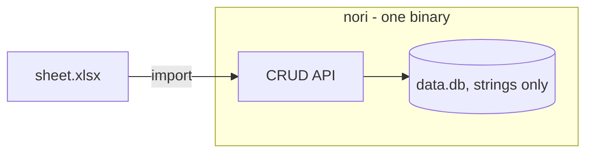
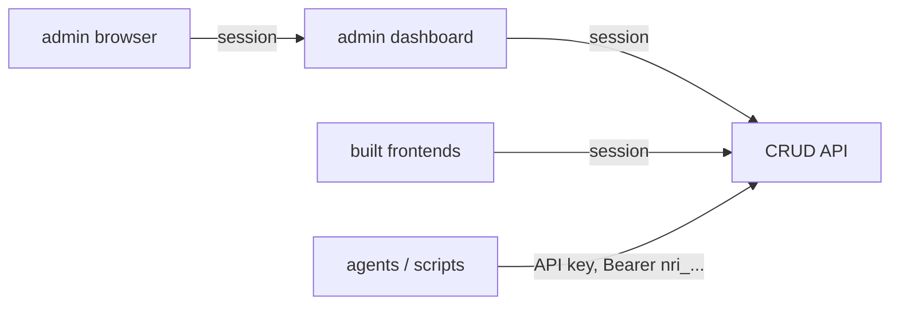

# Architecture

The README tells you how to use nori; this page is the core ideas in one
place.

## What nori is

> Import a spreadsheet, get an API. Every sheet becomes a table with a CRUD
> API, accounts, and an admin dashboard behind login: one private place for
> the data, and a stable contract that any frontend can be built against,
> thrown away, and rebuilt without touching the data.





## Core ideas

- **Single-node by design.** The moment you need a cluster, you need a
  real database.
- **Whole-table rewrites are crash-safe.** A replace-import, column
  rename or table rename builds the new dataset in a staging collection
  with a manifest, and boot replays or abandons the pending swap - the
  old table survives unless the new data is complete
  (`internal/store/rows.go`).

  ```mermaid
  flowchart TD
      w["whole-table rewrite"] --> s["build new dataset in staging"]
      s --> m["write the manifest"]
      m --> d["drop the live table"]
      d --> l["staging becomes live"]
      b["next boot"] --> q{"manifest left over?"}
      q -- "yes: replay the swap" --> d
      q -- no --> ok["old or new, never a half table"]
      l --> ok
  ```

- **The engine is a document store.** Cells are strings, columns are
  metadata, schema lives outside the documents. No joins, no per-column
  indexes, no native typed storage, no required columns: relating two
  tables means storing an id in a text column and resolving it in the
  client. When the data needs joins, it needs a real database
  (`internal/store`).
- **Types are hints, storage is strings.** Values are stored as strings
  and normalized on write (numbers sort numerically, dates validate,
  datetimes canonicalize to UTC); the type never changes storage
  (`internal/store/types.go`).
- **The spec is generated from code.** /openapi.json is built from the
  same code as the handlers, and a route-coverage test fails when any
  route is missing from the spec; llms.txt points at it. Each request
  adds typed paths for the tables that exist then
  (`internal/api/openapi.go`, `internal/api/openapi_tables.go`).
- **Stated limits.** 200,000 rows, 256 columns, 64MB imports - stated in
  /api/usage, the dashboard, llms.txt and README. Raising one means
  updating every place it is stated (`internal/store/types.go`).
- **Humans get sessions, machines get keys.** Login damps guesses and
  never locks anyone out. The dashboard is admin-only (so is anything
  new); editor and viewer accounts are API identities. New API keys
  default to builder: the schema without the rows (`internal/auth/auth.go`).
- **Every change is attributable.** Updates record the changed fields,
  deletes keep the full row, keys record `key:<name>` - and while
  flushes fail, events drop with a count instead of silently vanishing
  (`internal/api/audit.go`).
- **The dump keeps the engine replaceable.** Scheduled and once on
  shutdown, the dump is engine-independent JSON; restore refuses
  non-fresh data dirs and dumps of another format version
  (`internal/backup/backup.go`).

  ```mermaid
  flowchart LR
      n["nori"] -- "every backup-every + shutdown" --> g[("nori-dump-*.json.gz")]
      g -- "nori restore, fresh dir only" --> f[("new data dir")]
  ```

- **Search is a linear contains-scan.** Substring search has no index
  that helps; above the row cap the answer is a real database
  (`internal/store/rows.go`).
